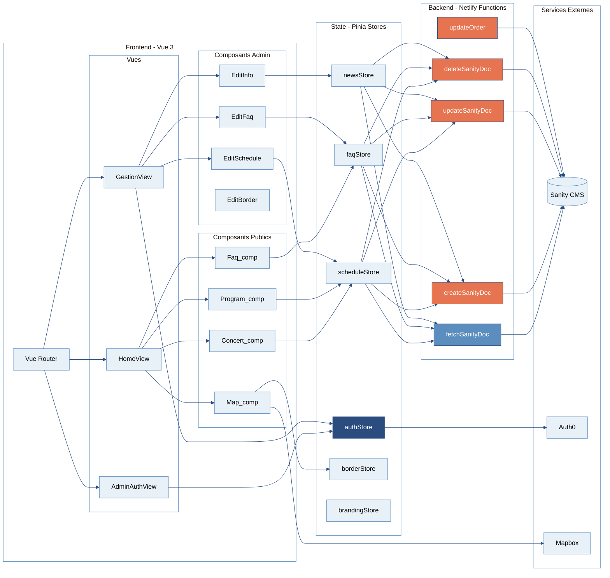
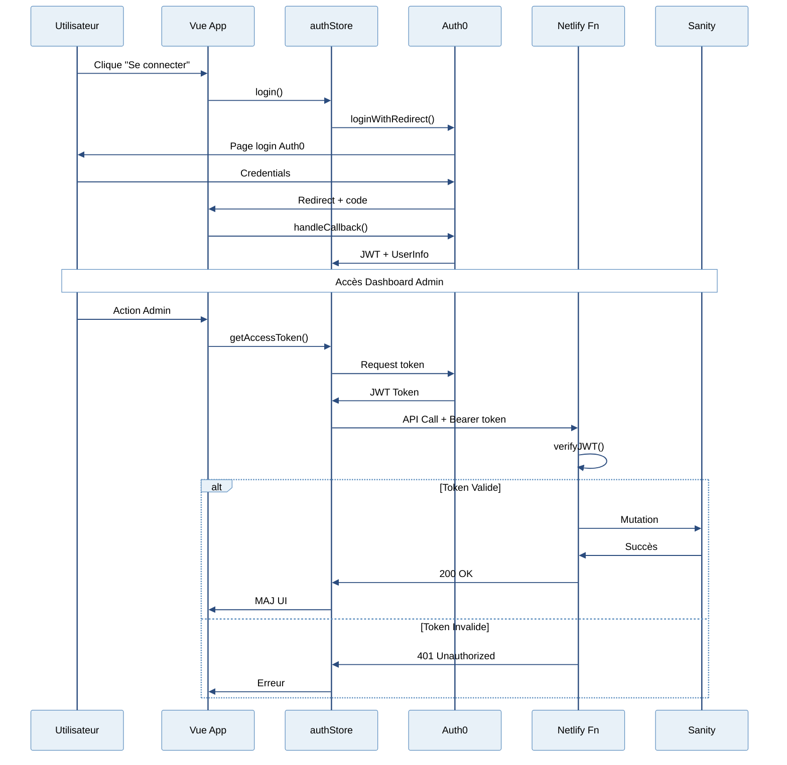
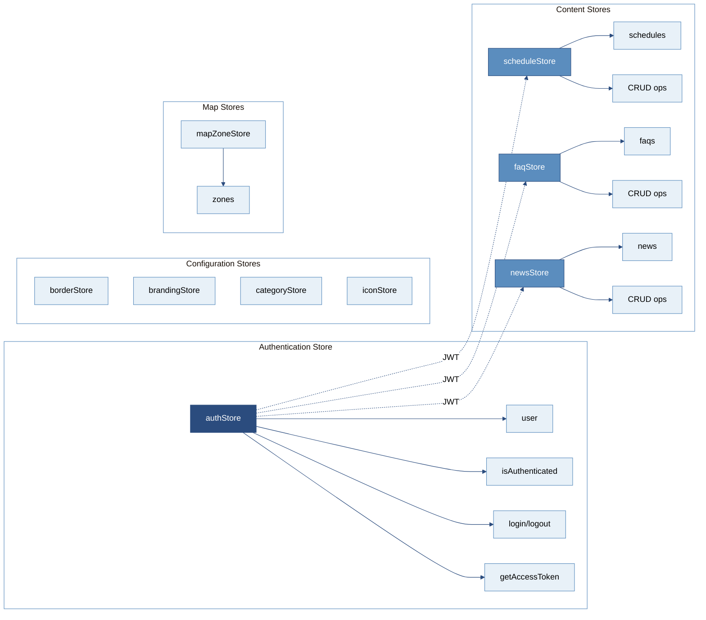
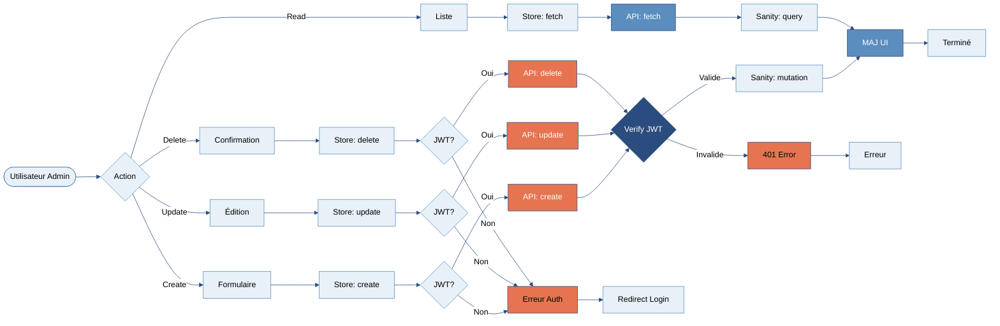
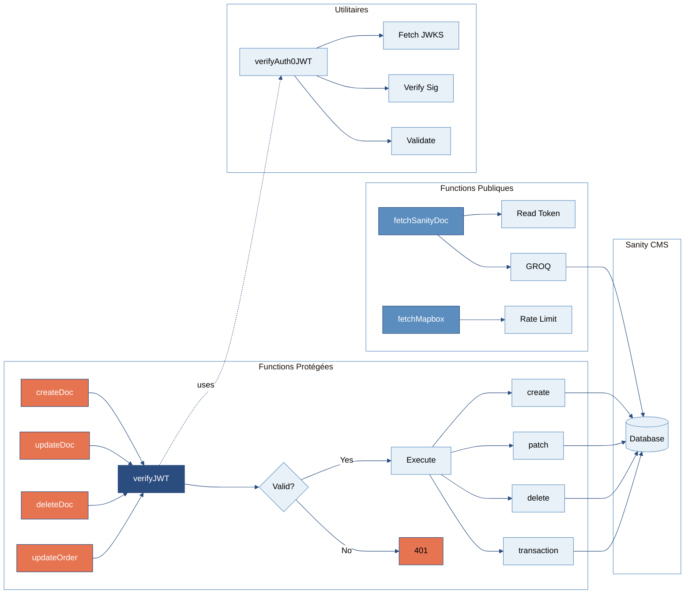
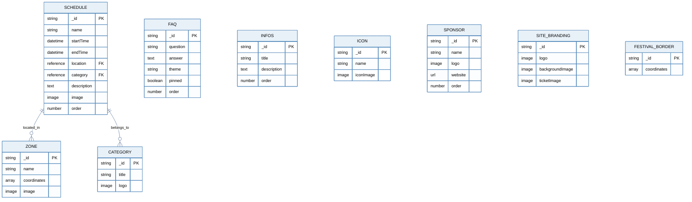
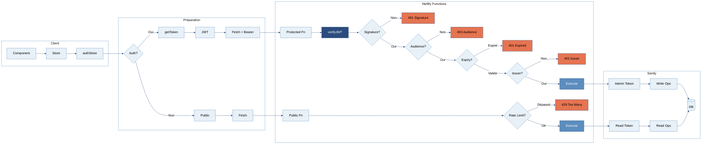
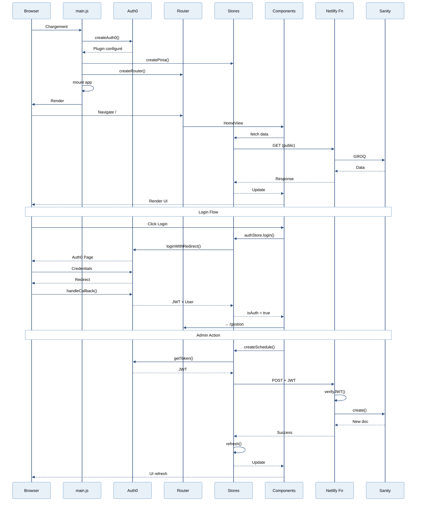
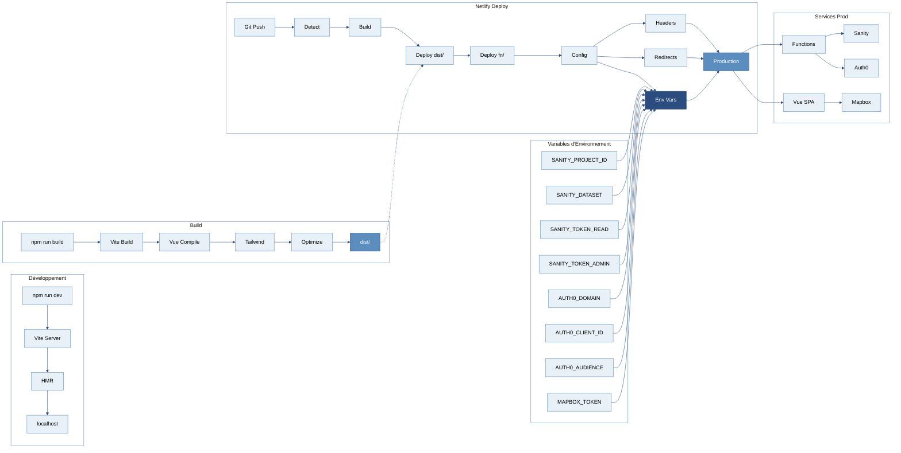

# Architecture du Projet Pateuf Festival

## Palette de Couleurs du Projet

- **Sunrise Orange (#E67451)** : Actions critiques / Endpoints protégés
- **Sunrise Blue (#2B4C7E)** : Composants principaux / Authentification
- **Dawn Blue (#5B8DBE)** : Composants secondaires / Lecture
- **Sky Light (#E8F1F8)** : Fond / Utilitaires

---

## 1. Architecture Globale du Système



---

## 2. Flux d'Authentification Auth0



---

## 3. Architecture des Stores Pinia



---

## 4. CRUD Operations Flow



---

## 5. Structure des Netlify Functions



---

## 6. Schémas de Données Sanity



---

## 7. Routing et Navigation

```mermaid
%%{init: {'theme':'base', 'themeVariables': { 'primaryColor':'#E8F1F8','primaryTextColor':'#000','primaryBorderColor':'#5B8DBE','lineColor':'#2B4C7E','secondaryColor':'#E8F1F8','tertiaryColor':'#E8F1F8','background':'#E8F1F8','mainBkg':'#E8F1F8','secondaryBkg':'#E8F1F8','tertiaryBkg':'#E8F1F8','clusterBkg':'#FFFFFF','clusterBorder':'#5B8DBE','edgeLabelBackground':'#FFFFFF'}}}%%
graph LR
    ROOT[/] --> ROUTER{Router}

    ROUTER --> HOME[HomeView]
    ROUTER --> AUTH_VIEW[AdminAuthView]
    ROUTER --> GESTION[GestionView]

    HOME --> H_SEC{Sections}
    H_SEC --> H1[Header]
    H_SEC --> H2[Programme]
    H_SEC --> H3[Carte]
    H_SEC --> H4[FAQ]
    H_SEC --> H5[Billeterie]
    H_SEC --> H6[Sponsors]

    AUTH_VIEW --> AUTH_CHECK{Auth?}
    AUTH_CHECK -->|Non| LOGIN[Login Form]
    AUTH_CHECK -->|Oui| REDIR_G[→ /gestion]

    GESTION --> G_CHECK{Auth?}
    G_CHECK -->|Non| REDIR_A[→ /auth]
    G_CHECK -->|Oui| ADMIN[Dashboard]

    ADMIN --> A_COMP{Composants}
    A_COMP --> A1[EditSchedule]
    A_COMP --> A2[EditFaq]
    A_COMP --> A3[EditInfo]
    A_COMP --> A4[EditBorder]

    style HOME fill:#5B8DBE,stroke:#2B4C7E,color:#fff
    style AUTH_VIEW fill:#2B4C7E,stroke:#2B4C7E,color:#fff
    style GESTION fill:#E67451,stroke:#2B4C7E,color:#fff
    style ADMIN fill:#E8F1F8,stroke:#5B8DBE,color:#000
```

---

## 8. Sécurité et Protection des Endpoints



---

## 9. Lifecycle de l'Application



---

## 10. Déploiement et Build Process



---

## Légende des Couleurs

| Couleur | Code | Usage |
|---------|------|-------|
| 🔵 **Sunrise Blue** | #2B4C7E | Authentification / Composants principaux |
| 🔷 **Dawn Blue** | #5B8DBE | Lecture / Succès / Composants secondaires |
| 🟠 **Sunrise Orange** | #E67451 | Erreurs / Actions protégées / Critique |
| ☁️ **Sky Light** | #E8F1F8 | Fond / Utilitaires / Configuration |

---

## Notes Techniques

- **Authentification** : Toutes les mutations nécessitent JWT Auth0 valide
- **Sécurité** : Lectures publiques avec token read-only Sanity
- **Performance** : Rate limiting sur endpoints publics
- **Headers** : CSP configuré pour Auth0, Mapbox, Sanity
- **Tokens** : Refresh automatique via Auth0 SDK
